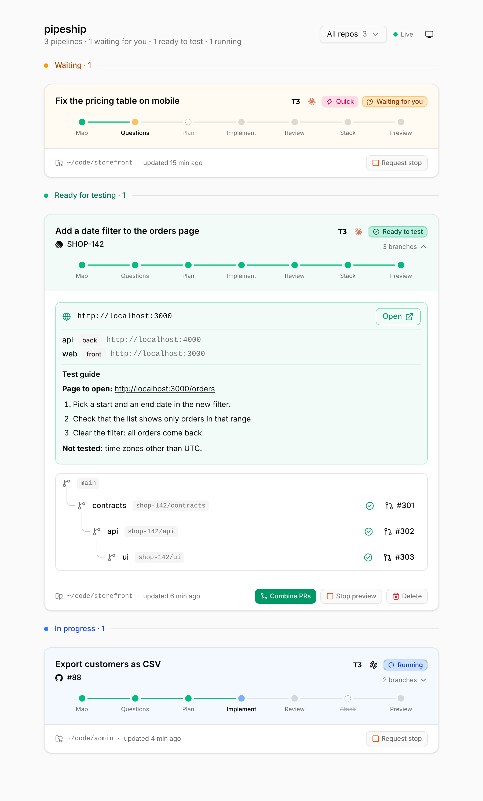

# pipeship

Feature pipeline for Claude Code and Codex. Give it a ticket or an issue from any source; it maps the code, asks its questions in one batch, plans, implements chunks in parallel worktrees, cleans up the code, opens stacked PRs, and starts the app so you can test it at a URL.

## Install

Requires [Bun](https://bun.sh), git and `gh`.

In Claude Code, from your shell, then start a new session:

```sh
claude plugin marketplace add simonzsh/pipeship
claude plugin install pipeship@pipeship
```

Or in one step inside a session: `/plugin install pipeship --marketplace simonzsh/pipeship`. Updates arrive with `claude plugin update pipeship@pipeship`, or automatically once you turn on auto-update for the marketplace in `/plugin`.

In Codex, from your shell, then start a new session:

```sh
codex plugin marketplace add simonzsh/pipeship
codex plugin add pipeship@pipeship
```

The first run installs the dependencies, which takes a few seconds.

To work on pipeship itself, clone the repo, run `bun install`, and link the skill instead: `ln -s "$PWD/skills/pipeship" ~/.claude/skills/pipeship`. Changes then apply at once.

## Usage

Give pipeship a ticket: a reference (`ABC-123`), a URL (Linear, Notion, GitHub, Jira…) or plain text. It reads the ticket with the tools your session has, such as an MCP server or `gh`.

### In Claude Code

Type `/pipeship:pipeship` followed by the ticket (`/pipeship` if you use the dev link):

```
/pipeship:pipeship ABC-123
/pipeship:pipeship quick https://github.com/org/repo/issues/42
/pipeship:pipeship --skip questions,stack "Add a date filter to the orders page"
```

You can also ask in plain words: "ship ABC-123 with pipeship".

### In Codex

In Codex, `$` calls a skill by name (type `$` to pick one from a list):

```
$pipeship ABC-123
$pipeship quick https://github.com/org/repo/issues/42
```

You can also ask in plain words: "ship ABC-123 with pipeship". pipeship writes to `~/.pipeship`, starts background servers and pushes branches, so Codex's default sandbox asks for approval: approve these commands, or run Codex with a sandbox that allows them.

### Options

- **Modes**: `full` (default, all 7 steps) and `quick` (one chunk, blocking questions only).
- **`--skip`** removes steps, e.g. `--skip questions,stack`. You can also say "skip the review" during the run.
- pipeship only starts when you name it. It does not run on ordinary feature requests.

## Test environment

At the end of a pipeline, the app runs from the feature's worktree on a free port from 3100, at `http://<ticket>.localhost:<port>`.

You do not configure anything: on the first pipeline in a repo, Claude reads the project and writes a recipe (install and start commands, port variable, local files to copy). Once the app starts, the recipe is saved in `~/.pipeship/recipes/` and reused. To share a recipe with your team, commit it as `.pipeship.json` at the repo root:

```json
{ "install": "bun install", "start": "bun run dev", "portEnv": "PORT", "copyFiles": [".env.local"], "readyPath": "/" }
```

## Dashboard

`scripts/pipeship dashboard` starts it in the background on http://localhost:4400 (the skill does it for you). It lists pipelines live, with their steps, PRs and test URL. It can stop a pipeline or its test server, and delete a finished pipeline: its worktrees and files go, its branches and PRs stay. Light and dark themes follow your system, with a toggle.

The page is React, Tailwind and [shadcn/ui](https://ui.shadcn.com) components (`src/dashboard/`). Bun builds it in memory when the dashboard starts: no Vite, no build step. Stop the dashboard with `scripts/pipeship dashboard stop`.

State lives in `~/.pipeship/pipelines/<id>/` (`state.json`, `ticket.md`, `map.md`, `plan.md`, worktrees, `preview.log`).

<picture>
  <source media="(prefers-color-scheme: dark)" srcset="docs/dashboard-dark.png">
  
</picture>

## Develop

```sh
bun test
bun run typecheck
```

To release, bump `version` in `package.json`, `.claude-plugin/plugin.json` and `.codex-plugin/plugin.json`, then push. Users only get an update when the version changes; a test checks that the three files agree.
