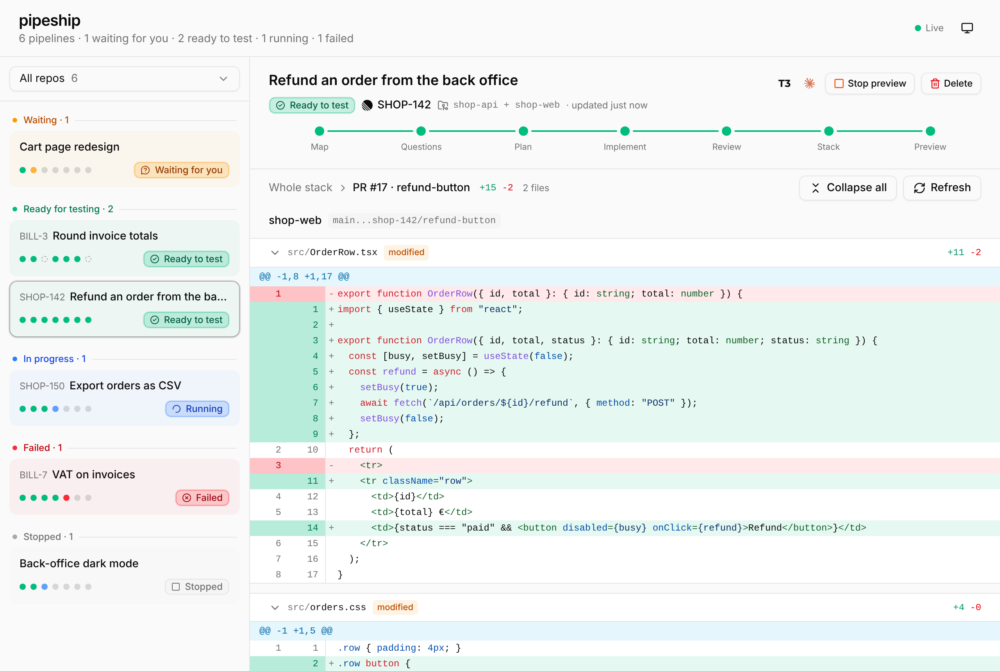

# pipeship

Feature pipeline for Claude Code and Codex. Give it a ticket, an issue or a work request from any source; it maps the code, asks its questions in one batch, plans, implements chunks in parallel worktrees, cleans up the code, opens one PR per repo, and starts the app so you can test it at a URL. It works with [T3 Code](https://github.com/pingdotgg/t3code): each pipeline links back to its T3 Code thread.

## Install

Requires [Bun](https://bun.sh), git and `gh`.

In Claude Code, from your shell, then start a new session:

```sh
claude plugin marketplace add simonzsh/pipeship
claude plugin install pipeship@pipeship
```

Or in one step inside a session: `/plugin install pipeship --marketplace simonzsh/pipeship`. Updates arrive with `claude plugin update pipeship@pipeship`, or automatically once you turn on auto-update for the marketplace in `/plugin`.

In Codex, from your shell, then start a new session:

```sh
codex plugin marketplace add simonzsh/pipeship
codex plugin add pipeship@pipeship
```

The first run installs the dependencies, which takes a few seconds.

To work on pipeship itself, clone the repo, run `bun install`, and link the skill instead: `ln -s "$PWD/skills/run" ~/.claude/skills/run`. Changes then apply at once.

## Usage

Give pipeship a ticket or a work request: a reference (`ABC-123`), a URL (Linear, Notion, GitHub, Jira…) or plain text. It reads the ticket with the tools your session has, such as an MCP server or `gh`. Without a ticket, your work request is the ticket.

### In Claude Code

Type `/pipeship:run` followed by the ticket or the request (`/run` if you use the dev link):

```
/pipeship:run ABC-123
/pipeship:run quick https://github.com/org/repo/issues/42
/pipeship:run --skip questions,stack "Add a date filter to the orders page"
```

You can also ask in plain words: "handle ABC-123 with pipeship".

A SessionStart hook runs after startup, resume, clear or compact. It always injects a routing rule: a work request on code (a ticket to handle, a feature, a fix, a change in a repo) goes through `pipeship:run`, even when it comes with a detailed plan; a small edit in one file, a question, a review or a status request does not. When the session has unfinished pipelines, it adds a reminder: their step and folder, the key rules, and the path of the skill to re-read. The hook comes with the plugin install: the dev symlink of `skills/run` gets no hook.

Codex discovers the same hook (`hooks/hooks.json` of the plugin). See "In Codex" for its trust step.

### In Codex

In Codex, `$` calls a skill by name (type `$` to pick one from a list):

```
$run ABC-123
$run quick https://github.com/org/repo/issues/42
```

You can also ask in plain words: "handle ABC-123 with pipeship". pipeship writes to `~/.pipeship`, starts background servers and pushes branches, so Codex's default sandbox asks for approval: approve these commands, or run Codex with a sandbox that allows them.

Codex discovers the plugin hook, but it is untrusted by default: review it in `/hooks`. It does not run until you trust it. If you prefer not to trust it, add this rule to your `AGENTS.md` instead:

```
pipeship: when the user asks for work on code (a ticket to handle, a feature, a fix, a refactor, a change in a repo),
invoke the `pipeship:run` skill (`$run` in Codex) before you read or change code. Pass the ticket, or the request with its plan, as the argument.
This holds for a delegated request too, even when it comes with a step-by-step plan.
Do not use it for a small edit in one file, a config tweak, a question, a review or a status request.
```

### Options

- **Modes**: `full` (default, all 7 steps) and `quick` (one chunk, blocking questions only, explore in the main session, one `sonnet` cleanup pass instead of the full review, no `opus`).
- **`--skip`** removes steps, e.g. `--skip questions,stack`. You can also say "skip the review" during the run. Steps run in order: `pipeship step` and `pipeship wait` refuse a step whose earlier steps are not done or skipped, so mark a step `skipped` to pass it.
- **Several repos**: a ticket can span several repos. Pass `--repo` once per repo, or let the explore step find them. Each repo gets its own PR.
- **Checks**: subagents run the fast checks (typecheck, lint, format) and only the tests related to the diff, never the full suite. CI runs the full suite on each PR. pipeship runs the full suite locally, once on the top of the stack, only when CI does not run it on PRs or when you ask for it. Never two test suites at once on the machine.
- pipeship starts on its own on a work request: make, fix, build or change something, with or without a ticket (a reference, a URL, a text, or a task decided after a discussion). You do not need to name it. It never starts on a question, an explanation, a plain discussion, a review or a status request.

## Test environment

At the end of a pipeline, the app runs from the feature's worktree. Each front service takes the first free port from 3000. Back ends and other kinds take the first free port from 4000 (4400, the dashboard, is skipped). Every service is served at `http://localhost:<port>`.

You do not configure anything: on the first pipeline in a repo, Claude reads the project and writes a recipe (install and start commands, port variable, local files to copy). Once the app starts, the recipe is saved in `~/.pipeship/recipes/` and reused. To share a recipe with your team, commit it as `.pipeship.json` at the repo root:

```json
{ "install": "bun install", "start": "bun run dev", "portEnv": "PORT", "copyFiles": [".env.local"], "readyPath": "/" }
```

This recipe is one front service. For a monorepo, list `services` instead. pipeship picks every port first, so a service can read another one's port in `env`. Back ends start first, then fronts; each service must answer on its `readyPath` before the next one starts.

```json
{
  "install": "pnpm install",
  "services": [
    { "name": "api", "kind": "back", "start": "pnpm --filter api dev", "portEnv": "API_PORT", "readyPath": "/health" },
    { "name": "web", "kind": "front", "start": "pnpm --filter web exec next dev -p $PORT",
      "env": { "API_URL": "http://localhost:${api.port}" } }
  ]
}
```

For a ticket that spans several repos, give each service its `repo` (the repo's folder name). It runs from the top worktree of that repo. Put `install` and `copyFiles` on the services. The recipe is saved for this set of repos. A pipeline with several repos never reads `.pipeship.json`.

```json
{
  "services": [
    { "name": "api", "kind": "back", "repo": "shop-api", "install": "pnpm install", "copyFiles": [".env"],
      "start": "pnpm dev", "portEnv": "PORT", "readyPath": "/health" },
    { "name": "web", "kind": "front", "repo": "shop-web", "install": "bun install",
      "start": "bun run dev --port $PORT", "env": { "API_URL": "http://localhost:${api.port}" } }
  ]
}
```

A service that cannot take its port from the environment can set `"fixedPort": <port>`. pipeship then refuses to start a second pipeline that shares a repo while one test environment runs.

## Review

Use `review` when you want a review and no code change. It reviews a PR, a branch or the current diff.

```
/pipeship:review 42
/pipeship:review https://github.com/org/repo/pull/42
/pipeship:review feat/x
/pipeship:review
```

With no argument, it reviews the current diff against `origin/<default branch>`, uncommitted and untracked files included. It diffs a PR or a branch from its merge base with `origin/<base>`. In Codex, call it with `$review`, for example `$review 42`.

It reuses the global review and cleanup briefs of `run` (`skills/run/prompts/`) and starts both subagents together: the global review on `opus`, the cleanup on `sonnet`. Both only report. It then merges the reports, re-reads the code of each finding and drops the false positives.

It starts only when you ask for a review. It creates no pipeline, writes no code, pushes nothing and does not comment on the PR unless you ask. To fix the findings, use `run`.

It answers with a ranked list of real problems. Each one has a `file:line` and a concrete failure scenario. Optional cleanups follow. If nothing real is found, it says so.

For the dev link, link both skills side by side: `ln -s "$PWD/skills/review" ~/.claude/skills/review` next to the `run` link. `review` reads the briefs of `run` through `../run/prompts`. The `/run` and `/review` dev links may collide with built-in commands. The plugin names `/pipeship:run` and `/pipeship:review` are namespaced.

## Dashboard

The dashboard on http://localhost:4400 has two columns.

- **Left: the pipelines**, grouped by status, each with its ticket, its steps and its status. The repo filter sits on top of the list.
- **Right: the selected pipeline.** The first one is selected by default, and `?p=<id>` in the URL links to a pipeline. The header stays on top while the rest scrolls: title, status, ticket links, repos, steps, and the actions.

Under 900 px the page shows one column, with a back button on the detail. Light and dark themes follow your system, with a toggle.

Each pipeline's header shows the logo of the agent that runs the pipeline (Claude Code or Codex). Click it to copy the command that reopens the session in its folder. Pipeship stores the harness, the session id, the folder and the T3 Code thread, never a pid or a token.

<picture>
  <source media="(prefers-color-scheme: dark)" srcset="docs/dashboard-dark.png">
  
</picture>

### Actions

The header can request a pipeline stop (the agents stop after their current step; the pipeline shows "Stopped"), stop the test servers ("Stop preview": a ready pipeline becomes done) and start them again ("Start preview" on a done pipeline, with no confirmation; a failure shows in the Test tab). A pipeline is `ready` while its preview runs and `done` when every step is finished and no preview runs. A done, failed or stopped pipeline can be archived ("Archive", with a confirmation): it moves to the collapsed "Archived" group, out of the header count, and cannot be unarchived. A pipeline whose PRs are all merged (by the merge engine or on GitHub) is archived by itself once every repo's merge has ended; it is archived when it is ready, done, failed or stopped, and its preview stops. A finished pipeline can be deleted: its worktrees and files go, and so do the local branches of its merged chunks; the other branches and the PRs stay.

The PR list is always visible, with one row per repo: its path, its chunks and its merge button. The PR of each repo merges with one violet "Merge into <base>" button, after a confirmation. The confirmation has a checkbox, checked by default, that deletes the remote branch of the PR after the merge (never the base). One run does it all. It waits for the checks on the PR and merges it into the base branch with a merge commit (never a squash), so the chunk commits stay in its history. A repo with 2 or more PRs not merged (a stack from an older version) is refused with a message: merge that stack on GitHub, or with an older pipeship. The run stops when the PR cannot merge, or when GitHub refuses merge commits, with the reason in the pipeline's detail, and the same button resumes it. One merge runs at a time per repo; the repos of a pipeline can merge at the same time.

The dashboard also syncs PR statuses with GitHub. At startup, on page load and every 60 seconds, it runs `gh pr view` for each chunk that has a PR and is not merged. It skips pipelines with no such PR, and the repos of a pipeline while they merge. Once the PR of a repo is merged, by the button or on GitHub, every chunk of that repo becomes `merged`. A PR closed without merge sets its chunk to `closed`, and a reopened PR sets it back to `done`. Without `gh`, or on an error, the state stays as it is and the error goes to `~/.pipeship/dashboard.log`. While any merge runs, the Delete button stays disabled. The merge buttons stay for a closed PR: Merge then fails with "PR #n is closed". The page-load check runs at most once every 15 seconds. In the pipeline list, a violet merge icon shows that all PRs of a pipeline are merged.

### Test tab

The test URLs, one per service, and the agent's `test.md` guide: the page to open, the steps to follow, what could not be tested. You can test without leaving the dashboard. Code blocks in the guide are highlighted.

### Code tab

The code diff, to review the work without leaving the dashboard.

- **Whole repo** by default: `<base>...<top branch>`, one diff per repo.
- **One chunk**: click it for `<previous chunk's branch>...<branch>`. The chunks are grouped under the PR that holds them; chunks with no PR yet sit under "No PR yet". The breadcrumb ("Whole repo › <chunk>") or the base branch row brings you back.
- Every file opens as a collapsible block with its line numbers, its +/− counts and syntax highlighting. "Collapse all" and "Expand all" toggle every file; "Refresh" reloads the diff.

The base of each diff is `origin/<base>`, fetched before each diff: a base that moved on the remote does not add its commits to the diff. The other end is the local branch (or `origin/<branch>` when the local one is gone). When the local branch differs from `origin/<branch>`, a badge says so, for example "2 commits not pushed": the PR on GitHub does not show this work yet. A missing branch shows a message in its repo's section.

<picture>
  <source media="(prefers-color-scheme: dark)" srcset="docs/dashboard-code-dark.png">
  
</picture>

### T3 Code

pipeship recognizes when a session runs in [T3 Code](https://github.com/pingdotgg/t3code). The header then shows a **T3** button next to the agent logo. Click it to open that pipeline's session in the T3 Code desktop app (`t3code://threads/<environmentId>/<threadId>`, T3 Code 0.0.46 or later). Each pipeline opens its own thread, so you can jump from the dashboard to the right conversation.

`pipeship new` finds the thread in T3 Code's local database (`$T3CODE_HOME`, default `~/.t3`), read-only; `pipeship step` looks again until it is found. Without T3 Code, the header has no T3 button and nothing else changes.

### Run it

The pipeline starts the dashboard for you. To start or stop it yourself, use `/pipeship:dashboard` and `/pipeship:dashboard stop` in Claude Code, or `$dashboard` and `$dashboard stop` in Codex (from a terminal: `scripts/pipeship dashboard [stop]`). Stopping it leaves the pipelines and their test servers running.

When a newer version is on GitHub (`main`, checked at most once every 10 minutes), the bottom of the left column shows **Update available** with an **Update** button. It works for Claude Code and Codex installs (a git checkout shows a hint instead of the button). It updates every harness where pipeship is installed (`claude plugin update pipeship@pipeship`, and `codex plugin marketplace upgrade pipeship` then `codex plugin add pipeship@pipeship`), because one dashboard serves both. A failure in one harness does not block the other. It then restarts the dashboard on the same port, from the running copy or from a newer one, and reloads the page. It refuses while a test environment is starting or a merge runs. Pipelines and their test servers keep running.

The agent can do the same without the dashboard: ask it to update pipeship (`/pipeship:update` in Claude Code, `$update` in Codex), or run `scripts/pipeship update` from a terminal. When the dashboard runs, the command asks it to update and waits until it restarts on the new version. Otherwise it updates the installs itself. `scripts/pipeship update --check` only prints the running and the latest version. The current session keeps the old skills: start a new session to load the new ones.

The page is React, Tailwind and [shadcn/ui](https://ui.shadcn.com) components (`src/dashboard/`). Bun builds it in memory when the dashboard starts: no Vite, no build step.

State lives in `~/.pipeship/pipelines/<id>/` (`state.json`, `ticket.md`, `explore.md`, `plan.md`, `test.md`, worktrees, `preview.log`).

## Develop

```sh
bun test
bun run typecheck
```

GitHub Actions runs both on every pull request and on each push to `main` (`.github/workflows/ci.yml`).

The skill lives in `skills/run/`: `SKILL.md` (rules and steps), `recipe.md` (recipe format, read at step 7) and `prompts/` (one brief per subagent type). Feedback after the end of a pipeline goes through implement and review again.

To release, bump `version` in `package.json`, `.claude-plugin/plugin.json` and `.codex-plugin/plugin.json`, then push. Users only get an update when the version changes; a test checks that the three files agree.
